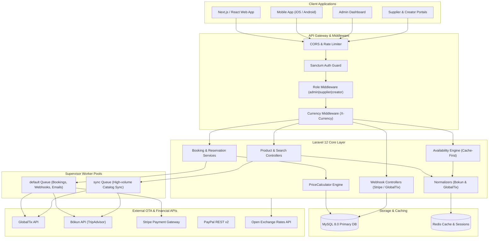
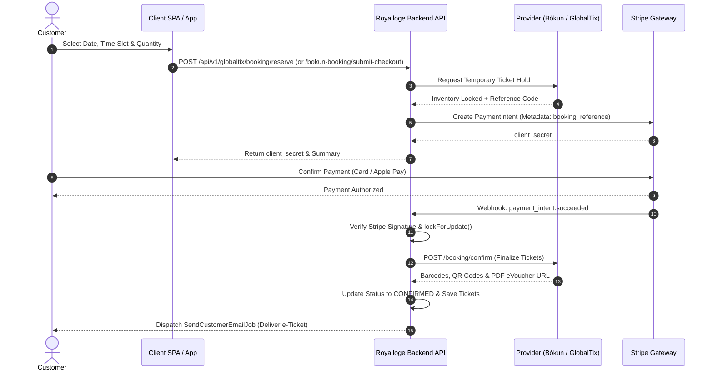

# 🌍 Things To Do Lists

> Enterprise-Grade Online Travel Agency (OTA) & Experiences Aggregation Platform

<p align="center">
  
</p>

<p align="center">
  <a href="https://github.com/imtiaz-ahamed-hridoy/ThingsToDoLists"></a>
  <a href="https://laravel.com"></a>
  <a href="https://www.php.net/"></a>
  <a href="https://www.mysql.com/"></a>
  <a href="https://redis.io/"></a>
  <a href="https://stripe.com"></a>
  <a href="https://pestphp.com/"></a>
  <a href="LICENSE"></a>
</p>

---

## 📌 Table of Contents

- [1. Project Name & Tagline](#1-project-name--tagline)
- [2. Used Technologies](#2-used-technologies)
- [3. Project Overview](#3-project-overview)
- [4. System Architecture & Workflow](#4-system-architecture--workflow)
- [5. Key Functional Modules & Flows](#5--key-functional-modules--flows)
- [6. Project Structure & API Reference](#6-project-structure--api-reference)
- [7. Environment Configuration (.env)](#7-environment-configuration-env)
- [8. Installation & Setup Commands](#8-installation--setup-commands)
- [9. Running the Application](#9-running-the-application)
- [10. Testing & Code Quality](#10-testing--code-quality)
- [11. CI/CD & Deployment](#11-cicd--deployment)
- [12. My Role & Contributions](#12-my-role--contributions)
- [13. Showcase Disclaimer](#13-showcase-disclaimer)

---

## 1. Project Name & Tagline

**Things To Do Lists (Royalloge Engine)**: A high-performance, multi-provider tour and activity booking platform aggregating global attraction tickets, guided expeditions, and local merchant experiences into a unified travel marketplace.

---

## 2. Used Technologies

### Backend & Core Framework
- **Laravel 12.0**: Modern enterprise PHP framework utilizing service providers, DTOs, and event-driven architecture.
- **PHP 8.3+**: Utilizing strict typing, match expressions, and readonly properties.
- **GuzzleHTTP 7.10**: High-concurrency HTTP client powering third-party API communication.

### Database & In-Memory Storage
- **MySQL 8.0+**: Primary relational datastore (54+ migrations, indexed foreign keys, JSON payload storage).
- **Redis 7.x**: In-memory cache, rate limiting, and high-throughput queue backing.

### Authentication & Authorization
- **Laravel Sanctum 4.0**: Token-based SPA and Mobile API authentication.
- **Role-Based Access Control (RBAC)**: Custom middleware distinguishing `Admin`, `Supplier`/`Vendor`, `Creator`, and `Customer` roles.
- **ichtrojan/laravel-otp 2.0**: Cryptographic 6-digit email OTP generation and expiration validation.

### Payment Gateways & External Integrations
- **Stripe PHP SDK 16.6**: PaymentIntents, Checkout Sessions, refunds, and HMAC-signed webhook handlers.
- **PayPal REST API v2**: Client credentials OAuth token caching and order capture lifecycle.
- **Bókun API (TripAdvisor Company)**: Custom **HMAC-SHA1 request signing** (`X-Bokun-Signature`) and multi-currency tour inventory.
- **GlobalTix API**: OAuth Bearer token caching, barcode/QR generation, e-Vouchers, and **HMAC-SHA256 webhooks**.
- **Open Exchange Rates API**: Automated daily currency sync against base EUR.

### DevOps, Testing & Quality
- **Pest PHP 3.8 & PHPUnit 11.x**: Comprehensive feature and unit testing suite.
- **Laravel Pint 1.13**: Automated PSR-12 code style enforcement.
- **Supervisor**: Linux daemon process monitoring isolating high-volume sync and real-time checkout workers.
- **GitHub Actions**: Automated CI/CD deployment pipeline template using least-privilege SSH execution.

---

## 3. Project Overview

### Problem Statement
Online travel agencies (OTAs) face severe architectural hurdles:
1. **Disparate Supplier Schemas**: Ticketing providers (GlobalTix, Bókun) format pricing, age brackets, time slots, and availability completely differently.
2. **Third-Party Latency & Rate Limits**: Live supplier queries on every search page create slow response times and risk provider rate limiting.
3. **Lost Booking Risks**: If a customer pays on Stripe but the provider API times out during confirmation, funds are captured without delivering a ticket.

### Business Value & Technical Solutions
- **Unified Catalog Abstraction**: Normalizes disparate vendor payloads into canonical `Product`, `ProductOption`, `OptionPricingCategory`, and `Price` models.
- **Cache-First Real-Time Availability**: Intelligent caching delivers sub-50ms calendar lookups, falling back to real-time provider calls only on cache expiration or forced updates.
- **Idempotent Webhook Confirmation Engine**: Database row locks (`lockForUpdate()`) and webhook signature verification guarantee zero double-bookings. If a provider confirms slowly, transactions transition to `PAID` with administrative retry alerts without re-charging the customer.
- **Dynamic Multi-Currency Engine**: Automated daily exchange rate sync updates the catalog in real time, converting prices dynamically based on the client's `X-Currency` header.

---

## 4. System Architecture & Workflow

### High-Level Architecture Flowchart



---

### End-to-End Booking & Payment Sequence



---

## 5. 🚀 Key Functional Modules & Flows

### A. Bókun (TripAdvisor) Direct Integration
- **Cryptographic Request Signing**: Every outbound HTTP call computes a base64-encoded HMAC-SHA1 signature using the current date, access key, HTTP method, and path:
  $$\text{Signature} = \text{Base64}(\text{HMAC-SHA1}(\text{Date} + \text{AccessKey} + \text{Method} + \text{Path}, \text{SecretKey}))$$
- **Real-Time Date/Time Allocation**: Queries bookable date slots and returns real-time seat capacities directly in the requested user currency.
- **Direct Reservation Flow**: Handles custom passenger fields, checkout questions, booking reservation holds, and e-voucher ticket extraction.

### B. GlobalTix Attraction Ticketing & Webhooks
- **Bearer Token Management**: Automatically caches and refreshes GlobalTix authentication tokens in Redis.
- **Catalog Normalization**: Standardizes dynamic Asian and international attraction ticket packages into unified age categories (`ADULT`, `CHILD`, `SENIOR`, `INFANT`).
- **HMAC-SHA256 Webhooks**: Validates signatures for inbound events (`BOOKING_TICKET_UPDATE`, `PRICE_UPDATE`, `TICKET_REDEEM`) and dispatches async queue jobs for non-blocking catalog updates.

### C. Resilient Stripe & PayPal Orchestration
- **PaymentIntent Metadata Linking**: Injects internal booking references into gateway metadata for two-way traceability.
- **Pessimistic Concurrency (`lockForUpdate()`)**: Locks the database row during webhook execution to avoid double-processing and race conditions.
- **Graceful Failure Handling**: If the provider times out after successful card payment, the system marks the transaction `PAID` with flag `needs_attention`, allowing administrators to trigger a one-click confirmation retry without re-charging the customer.

### D. Real-Time Availability & Caching
- **Cache-First Architecture**: Reads normalized date/slot data from cache; if stale or forced, queries provider APIs in real time and updates Redis with dynamic TTLs.

### E. Dynamic Multi-Currency Pricing Engine
- Daily scheduled task fetches live rates against base currency (EUR) from `open.er-api.com`.
- `CurrencyService` and middleware dynamically convert catalog items and checkout totals on demand based on the `X-Currency` header.

### F. Multi-Step Supplier Onboarding & Wizard
- Dedicated portal for local merchants to list and monetize activities:
  1. *Basic Details & Categorization*
  2. *Itinerary & Meeting Points*
  3. *Ticket Options & Pricing Tiers*
  4. *Media Gallery* (Ajax chunked uploads)
  5. *Cancellation Policies & FAQs*
  6. *Administrative Moderation Queue*

### G. Content Creator Portal & Collaborations
- Onboarding and tracking portal for travel creators applying for brand ambassador programs and sponsored experiences.

### H. Enterprise Queue Architecture & Catalog Sync
- **Worker Segregation**:
  - `default` queue: Processes customer checkouts, webhook events, and transactional emails with zero latency.
  - `sync` queue: Dedicated worker pool executing bulk catalog sync chunk jobs with extended 1500-second timeouts.
- **Queue Monitor**: Dashboard for real-time queue depths, job failure logs, and bulk retry controls.

---

## 6. Project Structure & API Reference

### Directory Structure

```
royalloge-backend/
├── app/
│   ├── Console/Commands/      # Scheduled commands (sync-all, sync-rates, queue-alert)
│   ├── DTOs/                  # Data Transfer Objects for provider payloads
│   ├── Enums/                 # Domain status and platform enumerations
│   ├── Http/
│   │   ├── Controllers/       # Admin & API controllers
│   │   ├── Middleware/        # Sanctum, Role, Currency, Language middleware
│   │   └── Requests/          # Form request validation classes
│   ├── Jobs/                  # Catalog sync chunk jobs & webhook handlers
│   ├── Models/                # 55 Eloquent models (catalog, bookings, CMS)
│   └── Services/              # BokunService, GlobalTixService, CurrencyService, Stripe
├── config/                    # Framework and service configuration files
├── database/
│   ├── migrations/            # 54+ database schema migrations
│   └── seeders/               # System seeders (roles, categories, currencies)
├── docs/
│   └── DEPLOYMENT.md          # CI/CD deployment pipeline documentation
├── routes/
│   ├── api/v1/                # Public and authenticated versioned API routes
│   ├── backend.php            # Admin management web routes
│   └── console.php            # Scheduled task definitions
└── tests/
    ├── Feature/               # End-to-end API, webhook, and auth tests
    └── Unit/                  # Service and pricing calculation tests
```

---

### Core Public Travel APIs (`/api/v1/`)

| Method | Endpoint | Auth | Description |
| :--- | :--- | :--- | :--- |
| `GET` | `/system-setting` | Public | Global portal branding, support info, and system configs |
| `GET` | `/home-page-sections` | Public | Dynamic homepage layout blocks and curated collections |
| `GET` | `/currencies` | Public | Supported currencies and exchange rates relative to EUR |
| `POST` | `/currencies/set` | Public | Sets active session/cookie currency |
| `GET` | `/city/list` | Public | Available destinations with active product counts |
| `GET` | `/product/list` | Public | Paginated experience catalog with faceted filters |
| `GET` | `/product/show/{id}` | Public | Detailed experience page with media, reviews, options, and rates |
| `POST` | `/availability/check` | Public | Real-time date/time slot availability check |
| `GET` | `/search` | Public | Headout-style autocomplete suggestions (cities, categories, products) |
| `GET` | `/search/global` | Public | Faceted search results page |
| `POST` | `/bookings/lookup` | Public | Booking lookup by reference code and email |
| `POST` | `/globaltix/booking/reserve` | Public | Reserves GlobalTix ticket hold + creates Stripe PaymentIntent |
| `POST` | `/globaltix/booking/release` | Public | Releases temporary GlobalTix ticket hold |
| `POST` | `/bokun-booking/submit-checkout` | Public | Submits Bókun reservation hold + creates Stripe PaymentIntent |
| `POST` | `/webhook/stripe` | Stripe HMAC | Idempotent Stripe webhook confirmation and ticket issuance |
| `POST` | `/webhook/globaltix/*` | GlobalTix HMAC | Multi-event webhooks for GlobalTix updates |
| `GET` | `/wishlist` | Optional | User or guest wishlist items |
| `POST` | `/wishlist/toggle` | Optional | Adds or removes product from wishlist |

---

### Authenticated Customer APIs (`/api/v1/`)

| Method | Endpoint | Middleware | Description |
| :--- | :--- | :--- | :--- |
| `POST` | `/login` | `guest:sanctum` | Customer authentication; returns Sanctum Bearer token |
| `POST` | `/register` | `guest:sanctum` | User registration; dispatches 6-digit email OTP |
| `POST` | `/email/verify` | `guest:sanctum` | Verifies email OTP and migrates guest wishlist to account |
| `POST` | `/password/forgot` | `guest:sanctum` | Dispatches password reset OTP |
| `POST` | `/password/reset` | `guest:sanctum` | Resets account password using verified token |
| `GET` | `/profile` | `auth:sanctum` | Returns authenticated user profile |
| `POST` | `/profile` | `auth:sanctum` | Updates profile name, phone number, and bio |
| `GET` | `/user/bookings` | `auth:sanctum` | Customer's past and upcoming booking history |
| `GET` | `/user/bookings/{ref}` | `auth:sanctum` | Single booking details with barcodes and downloadable vouchers |

---

### Supplier Dashboard APIs (`/api/v1/supplier-dashboard/`)

Protected by `auth:sanctum` and `role:supplier,vendor`:

| Method | Endpoint | Description |
| :--- | :--- | :--- |
| `GET` | `/supplier-dashboard/home` | Merchant analytics: total sales, active listings, revenue |
| `GET` | `/supplier-dashboard/products` | Lists experiences created by the authenticated merchant |
| `GET` | `/supplier-dashboard/create-products/draft/{id?}` | Resumes previously saved product draft |
| `POST` | `/supplier-dashboard/create-products/save-draft/{id?}` | Saves multi-section wizard draft |
| `POST` | `/supplier-dashboard/create-products/submit/{id?}` | Submits finished experience to admin for publication |
| `GET` | `/supplier-dashboard/bookings` | Bookings management for supplier's experiences |
| `GET` | `/supplier/finance/payouts` | History of bank payouts and transfer receipts |

---

## 7. Environment Configuration (.env)

Duplicate `.env.example` to `.env` and set the required variables:

```bash
cp .env.example .env
```

| Variable | Purpose | Example Placeholder |
| :--- | :--- | :--- |
| `APP_NAME` | Application name | `"Things To Do Lists"` |
| `APP_ENV` | Environment mode | `local` |
| `APP_KEY` | 32-character encryption key | `base64:...` |
| `APP_URL` | Base backend URL | `http://localhost:8000` |
| `FRONTEND_APP_URL` | Client SPA URL | `http://localhost:3000` |
| `CORS_ALLOWED_ORIGINS` | Allowed CORS origins | `http://localhost:3000,http://localhost:5173` |
| `DB_CONNECTION` | Database driver | `mysql` |
| `DB_HOST`, `DB_PORT` | Database host and port | `127.0.0.1`, `3306` |
| `DB_DATABASE` | Database name | `royalloge_dev` |
| `QUEUE_CONNECTION` | Queue connection | `redis` or `database` |
| `CACHE_STORE` | Cache store | `redis` or `database` |
| `STRIPE_KEY` | Stripe publishable key | `pk_test_placeholder` |
| `STRIPE_SECRET` | Stripe secret key | `sk_test_placeholder` |
| `STRIPE_WEBHOOK_SECRET` | Webhook verification secret | `whsec_placeholder` |
| `BOKUN_ACCESS_KEY` | Bókun API access key | `your_bokun_access_key` |
| `BOKUN_SECRET_KEY` | Bókun API secret signing key | `your_bokun_secret_key` |
| `GLOBALTIX_MODE` | GlobalTix environment mode | `test` or `prod` |
| `GLOBALTIX_PROD_BASE_URL` | GlobalTix production endpoint | `https://sg-api.globaltix.com` |
| `GLOBALTIX_WEBHOOK_SECRET` | GlobalTix webhook secret | `your_globaltix_webhook_secret` |
| `PAYPAL_MODE` | PayPal mode | `sandbox` or `live` |

---

## 8. Installation & Setup Commands

```bash
# 1. Clone repository
git clone https://github.com/imtiaz-ahamed-hridoy/ThingsToDoLists.git
cd ThingsToDoLists

# 2. Install PHP dependencies
composer install --optimize-autoloader

# 3. Install frontend asset dependencies
npm install

# 4. Configure environment
cp .env.example .env
php artisan key:generate

# 5. Run database migrations and seeders
php artisan migrate --seed

# 6. Create storage symlink
php artisan storage:link

# 7. Compile assets
npm run build
```

---

## 9. Running the Application

### Local Development

```bash
# Run web server, queue listener, and Vite concurrently:
composer run dev

# Or run services individually:
php artisan serve --port=8000
php artisan queue:listen --tries=1
php artisan schedule:work
```

### Production Deployment
Refer to [docs/DEPLOYMENT.md](docs/DEPLOYMENT.md) for automated GitHub Actions workflows, Supervisor worker configurations, and Crontab setups.

---

## 10. Testing & Code Quality

The test suite covers booking flows, webhook signature validation, and pricing normalizers:

```bash
# Run all automated tests
php artisan test

# Run tests via Pest directly
./vendor/bin/pest

# Run specific feature test
php artisan test tests/Feature/GlobalTixWebhookTest.php

# Code styling check via Laravel Pint
./vendor/bin/pint --test
```

---

## 11. CI/CD & Deployment

This repository includes a secure, generic deployment workflow template configured for GitHub Actions. Deployment instructions, required secrets, and security guidelines are documented in:

👉 **[docs/DEPLOYMENT.md](docs/DEPLOYMENT.md)**

---

## 12. My Role & Contributions

As the primary backend engineer on this project, I contributed to the architecture, core modules, and ongoing reliability of the platform:

- **GlobalTix Pricing & Normalization Engine**: Designed the live price synchronization service and implemented the `ADULT`-first lowest price resolution hierarchy to guarantee consistent catalog pricing.
- **Multi-Currency Reconciliation**: Diagnosed and resolved multi-currency conversion discrepancies between single product views and search catalog cards.
- **Provider Resilience & Webhook Idempotency**: Hardened the Stripe and GlobalTix webhook handling pipelines using database pessimistic row locking (`lockForUpdate()`), preventing race conditions and double-bookings.
- **Catalog Synchronization Pipelines**: Engineered non-blocking background queue synchronization with dedicated Supervisor worker pools to ingest large supplier catalogs without impacting real-time user traffic.
- **Test Suite Coverage & SQA**: Wrote feature test cases covering webhook signature verification, booking lifecycle states, and mock provider payloads.

---

## 13. Showcase Disclaimer

> **Notice**: This is a sanitized showcase of a client project, published with the client's permission. All production credentials, live secret keys, server infrastructure scripts, API client collections, and proprietary business data have been strictly removed.
