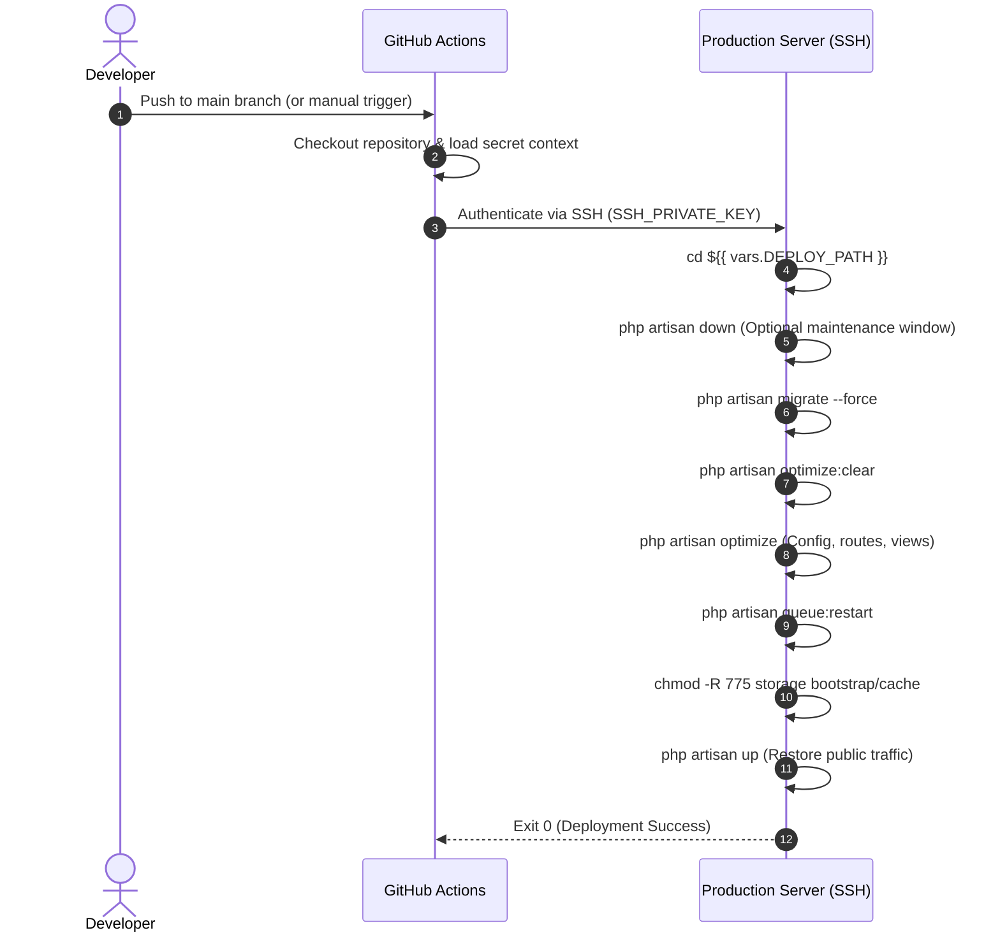

# 🚀 Deployment Architecture & CI/CD Pipeline

This document outlines the production deployment workflow for the **Things To Do Lists (Royalloge Engine)** platform. The workflow uses GitHub Actions over secure SSH execution with zero secrets stored in code or repositories.

---

## 1. Deployment Workflow Overview

The automated deployment pipeline triggers on pushes to the `main` branch or can be initiated manually via `workflow_dispatch`.



---

## 2. Required GitHub Secrets and Variables

Configure these settings in your repository under **Settings > Secrets and variables > Actions**.

### Required Secrets (Sensitive Credentials)

| Secret Name | Type | Purpose | Example Placeholder |
| :--- | :--- | :--- | :--- |
| `SSH_HOST` | Hostname / IP | Production server IP address or domain | `203.0.113.195` or `api.example.com` |
| `SSH_USER` | Username | Dedicated non-root deployment user | `deployer` |
| `SSH_PRIVATE_KEY` | Ed25519 / RSA Key | Private SSH key matching the server's `authorized_keys` | `<Ed25519_or_RSA_private_key_content>` |
| `SSH_PORT` | Port number | SSH daemon port (defaults to 22 if omitted) | `22` |
| `SSH_KNOWN_HOSTS` | Fingerprint | Expected host fingerprint for strict host verification | `api.example.com ssh-ed25519 AAAAC3...` |

### Required Repository Variables (Non-Secret Configuration)

| Variable Name | Type | Purpose | Example Placeholder |
| :--- | :--- | :--- | :--- |
| `DEPLOY_PATH` | Path | Absolute filesystem directory on target server | `/var/www/royalloge-api` |

---

## 3. Server Configuration & Key Setup

To follow security best practices:

### 1. Create a Dedicated Deployment User
Never deploy as `root`. Create an isolated system user on the server:

```bash
sudo adduser --disabled-password --gecos "" deployer
sudo usermod -aG www-data deployer
```

### 2. Generate an Isolated Deployment Key Pair
On your administrative workstation:

```bash
ssh-keygen -t ed25519 -C "github-actions-deploy" -f id_ed25519_deploy
```

- Append the public key (`id_ed25519_deploy.pub`) to `/home/deployer/.ssh/authorized_keys` on your server.
- Store the private key (`id_ed25519_deploy`) as `SSH_PRIVATE_KEY` in GitHub Secrets.

### 3. Grant Limited Sudo Privileges (If Needed)
If worker restarts require system privileges:

```bash
# /etc/sudoers.d/deployer
deployer ALL=(ALL) NOPASSWD: /usr/bin/supervisorctl restart royalloge:*
```

---

## 4. Security Hardening Notes

1. **Environment File Isolation**: Never commit `.env` to GitHub. The live `.env` resides exclusively on the production server.
2. **Key Rotation**: Rotate `SSH_PRIVATE_KEY` every 90 days.
3. **Environment Protection Rules**: Utilize GitHub Environments (e.g. `production`) with required reviewer approvals before deployment execution.
4. **Zero-Downtime Adaptations**: For blue-green deployments, replace direct SSH commands with tools like Laravel Deployer or Docker Swarm/Kubernetes rolling updates.
